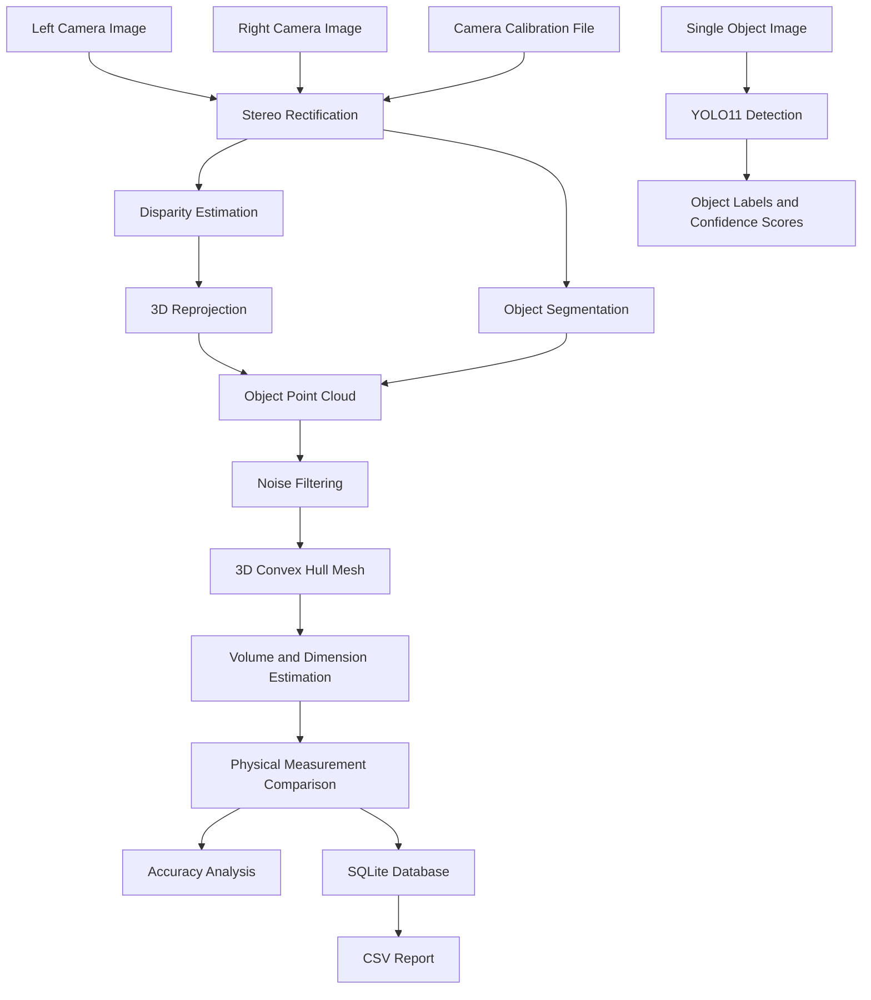
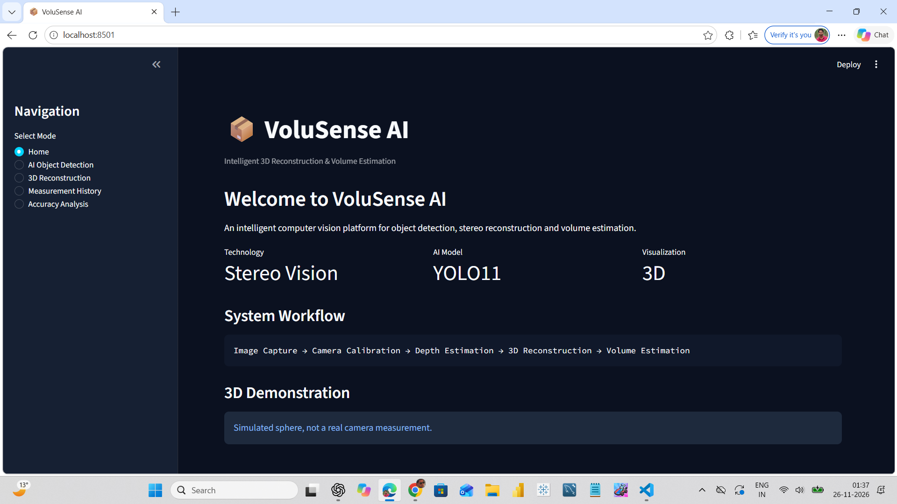
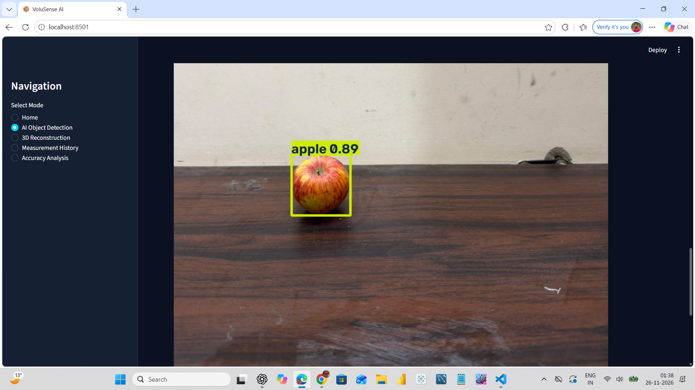
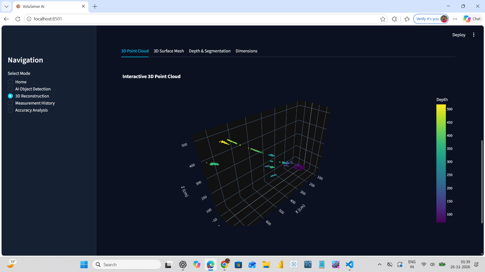
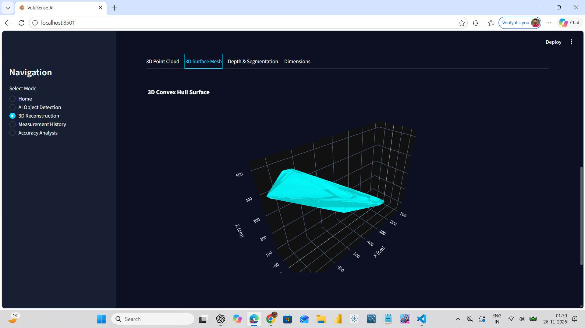
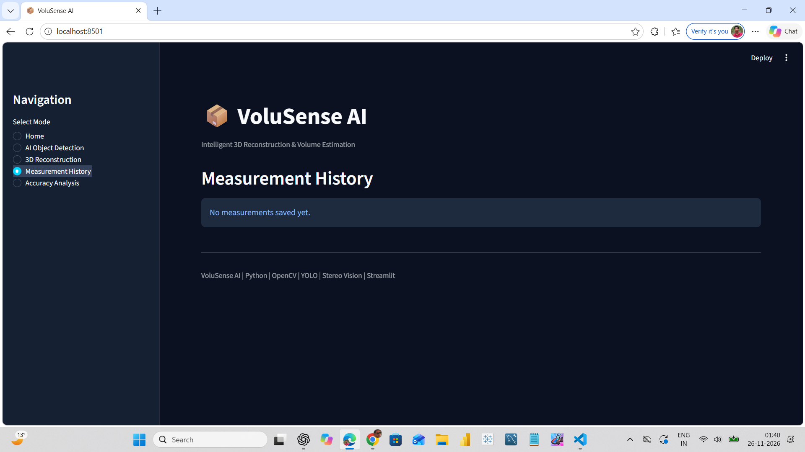
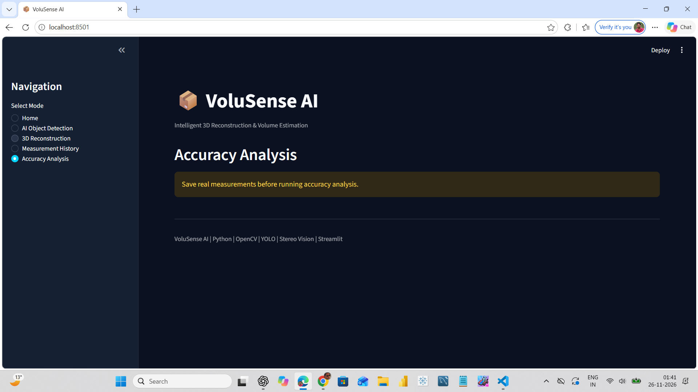

# 📦 VoluSense AI

### Intelligent 3D Reconstruction & Volume Estimation System


---

## 📖 Table of Contents

- Project Overview
- Problem Statement
- Objectives
- Key Features
- Technology Stack
- System Architecture
- Working Methodology
- Project Structure
- Installation
- Usage
- Project Screenshots
- Mathematical Concepts
- Performance Evaluation
- Dataset
- Real-World Applications
- Limitations
- Future Enhancements
- Developer

---

## 📌 Project Overview

VoluSense AI is an intelligent computer vision application
designed to reconstruct physical objects in three dimensions
and estimate their volume using calibrated stereo camera
images.

The platform combines artificial intelligence, computer
vision, image processing, mathematical modeling and
interactive 3D visualization to provide an automated
object measurement solution.

The system supports AI-based object detection, stereo
reconstruction, dimension estimation, volume calculation,
measurement history and experimental accuracy analysis
through an interactive Streamlit dashboard.

---

## 🎯 Problem Statement

Traditional object volume measurement methods require
physical instruments, manual calculations or water
displacement techniques.

These methods may be time-consuming and unsuitable for
automated applications in agriculture, logistics,
warehousing and industrial inspection.

VoluSense AI explores a camera-based approach to estimate
object dimensions and volume using stereo vision and
3D reconstruction.

---

## 🎯 Project Objectives

- Develop a computer vision-based volume estimation system.
- Perform stereo camera calibration using OpenCV.
- Detect supported objects using YOLO11.
- Generate disparity maps from stereo image pairs.
- Reconstruct objects as 3D point clouds.
- Generate approximate 3D surface meshes.
- Estimate object dimensions and volume.
- Compare estimated volumes with physical measurements.
- Store and analyze experimental measurement results.
- Provide an interactive and user-friendly dashboard.

---

## 🚀 Key Features

| Feature | Description |
|---|---|
| AI Object Detection | YOLO11-based object identification |
| Stereo Vision | Reconstruction using two camera views |
| Camera Calibration | Checkerboard-based camera calibration |
| Disparity Mapping | Stereo correspondence visualization |
| Object Segmentation | Foreground extraction using GrabCut |
| 3D Point Cloud | Interactive reconstructed 3D points |
| Surface Mesh | Convex hull-based approximate geometry |
| Dimension Estimation | Camera-axis width, height and depth |
| Volume Estimation | Mathematical volume approximation |
| Surface Area | Convex hull surface area calculation |
| Measurement History | Persistent SQLite storage |
| Accuracy Analysis | MAE, RMSE and MAPE |
| CSV Export | Downloadable measurement reports |
| Dashboard | Interactive Streamlit interface |

---

## 🛠️ Technology Stack

| Technology | Purpose |
|---|---|
| Python | Core programming language |
| OpenCV | Image processing and stereo vision |
| YOLO11 | AI-powered object detection |
| Ultralytics | Pretrained YOLO model framework |
| NumPy | Numerical and matrix operations |
| SciPy | Convex hull and geometric calculations |
| Pandas | Data processing and analysis |
| Plotly | Interactive charts and 3D visualization |
| Streamlit | Web application dashboard |
| SQLite | Database management |
| Pillow | Image loading and processing |
| Git & GitHub | Version control |

---

## 🏗️ System Architecture



---

## ⚙️ Working Methodology

### 1. Stereo Image Acquisition

Two cameras capture images of the same object from
different viewpoints while maintaining a fixed relative
camera position.

### 2. Camera Calibration

A checkerboard pattern is used to calculate intrinsic
and extrinsic camera parameters.

Calibration parameters are stored in an NPZ file.

### 3. Stereo Rectification

The left and right images are geometrically aligned
to simplify stereo correspondence.

### 4. Disparity Estimation

OpenCV StereoSGBM calculates pixel displacement
between corresponding image regions.

### 5. Object Segmentation

GrabCut separates the foreground object from
the background.

### 6. 3D Reconstruction

Disparity values and the calibration reprojection
matrix are used to reconstruct 3D coordinates.

### 7. Point Cloud Filtering

Invalid points and extreme depth outliers are removed
to improve the reconstructed point cloud.

### 8. Surface Mesh Generation

The SciPy ConvexHull algorithm generates an approximate
closed surface around the reconstructed points.

### 9. Volume Estimation

The volume and surface area of the convex hull are
calculated. Camera-axis dimensions are estimated from
the spatial extent of the point cloud.

### 10. Performance Evaluation

Estimated volume is compared with actual physical
measurements using statistical error metrics.

### Independent AI Detection Module

YOLO11 identifies supported object classes and displays
bounding boxes with confidence scores.

This module currently operates separately from the
stereo reconstruction pipeline.

---

## 📂 Project Structure

```text
VoluSense-AI/
│
├── .streamlit/
│   └── config.toml
│
├── screenshots/
│   ├── home.png
│   ├── object_detection.png
│   ├── point_cloud.png
│   ├── surface_mesh.png
│   ├── measurement_history.png
│   └── accuracy_analysis.png
│
├── app.py
├── ai_detector.py
├── calibration.py
├── volume_estimator.py
├── visualization.py
├── database.py
├── fix_calibration.py
├── resize_images.py
├── resize_objects.py
├── test_checkerboard.py
├── requirements.txt
├── .gitignore
└── README.md
```

Local dataset, calibration files, virtual environments
and database files are excluded from version control.

---

## 💻 Installation

### Prerequisites

- Python
- Git
- Visual Studio Code or another code editor
- Internet connection for dependency installation
  and initial YOLO model download

### Step 1: Clone the Repository

```bash
git clone https://github.com/SOFEEN-ZAID/VoluSense-AI.git
```

### Step 2: Open the Project Directory

```bash
cd VoluSense-AI
```

### Step 3: Create a Virtual Environment

```bash
python -m venv venv
```

### Step 4: Activate the Virtual Environment

Windows Command Prompt:

```cmd
venv\Scripts\activate
```

Linux or macOS:

```bash
source venv/bin/activate
```

### Step 5: Install Dependencies

```bash
python -m pip install -r requirements.txt
```

### Step 6: Run the Application

```bash
python -m streamlit run app.py
```

Open the local URL displayed in the terminal.

The default Streamlit address is:

```text
http://localhost:8501
```

---

## 🖥️ Application Modules

### 1. Home Dashboard

Provides a project overview, technology information
and a simulated interactive 3D demonstration.

### 2. AI Object Detection

Upload an image to identify supported objects using
the pretrained YOLO11 model.

Displays object labels, bounding boxes and
confidence scores.

### 3. 3D Reconstruction

Upload a compatible stereo calibration file and
matching left and right camera images.

The module generates:

- Interactive 3D point cloud
- Approximate 3D surface mesh
- Stereo disparity heatmap
- Object segmentation mask
- Estimated object dimensions
- Estimated volume
- Estimated surface area
- Percentage volume error when actual volume is provided

### 4. Measurement History

Stores measured and estimated volume records using
SQLite and provides downloadable CSV reports.

### 5. Accuracy Analysis

Displays statistical performance metrics and
interactive volume comparison charts.

---

## 📷 Project Screenshots

### Home Dashboard



### AI Object Detection



### Interactive 3D Point Cloud



### 3D Surface Mesh



### Measurement History



### Accuracy Analysis



---

## 📐 Mathematical Concepts

### Stereo Depth Estimation

For an ideal rectified stereo camera pair:

$$
Z = \frac{fB}{d}
$$

Where:

- Z = Object depth
- f = Camera focal length in pixels
- B = Camera baseline distance
- d = Stereo disparity in pixels

The implementation uses OpenCV's calibration
reprojection matrix to calculate 3D coordinates.

### Percentage Volume Error

$$
Error(\%) =
\frac{|V_e-V_a|}{V_a}\times100
$$

Where:

- Ve = Estimated volume
- Va = Actual measured volume

### Mean Absolute Error (MAE)

$$
MAE = \frac{1}{n}\sum_{i=1}^{n}|y_i-\hat{y}_i|
$$

### Root Mean Squared Error (RMSE)

$$
RMSE =
\sqrt{\frac{1}{n}\sum_{i=1}^{n}(y_i-\hat{y}_i)^2}
$$

### Mean Absolute Percentage Error (MAPE)

$$
MAPE =
\frac{100}{n}
\sum_{i=1}^{n}
\left|\frac{y_i-\hat{y}_i}{y_i}\right|
$$

Where:

- yi = Actual measured volume
- y-hat-i = Estimated volume
- n = Number of measurements

---

## 📊 Performance Evaluation

The system evaluates estimated object volume against
actual physical measurements.

| Metric | Description |
|---|---|
| MAE | Average absolute volume error |
| RMSE | Error metric emphasizing larger deviations |
| MAPE | Average percentage error |
| Percentage Error | Relative error for an individual object |

Experimental results can be saved in the measurement
database and exported as CSV reports.

Numerical performance depends on calibration quality,
camera positioning, object geometry and image quality.

---

## 📸 Dataset

The project uses a self-captured stereo image dataset
containing images of produce and package objects.

### Dataset Categories

- Checkerboard calibration images
- Left camera object images
- Right camera object images
- Physical reference volume measurements

### Local Dataset Structure

```text
dataset/
├── left/
├── right/
├── object_left/
├── object_right/
├── object_left_resized/
└── object_right_resized/
```

The dataset and calibration files are not included
in the public repository.

Users must capture their own compatible stereo image
pairs and generate a calibration file.

---

## 📏 Camera Calibration

The original project uses a checkerboard with:

- 10 squares across
- 7 squares down
- 9 × 6 internal corners
- Square size of 2.5 cm

Example calibration command:

```bash
python calibration.py --left dataset/left/left_resized --right dataset/right/right_resized --square-size 2.5 --columns 9 --rows 6
```

The input directories must contain matching
checkerboard image pairs.

The generated calibration file is stored at:

```text
calibration/stereo_calibration.npz
```

For compatibility with the original volume estimator:

```bash
python fix_calibration.py
```

Real reconstruction requires object images captured
with the same calibrated camera positions, orientation,
resolution and camera settings.

---

## 🌍 Real-World Applications

- Smart agriculture
- Fruit and vegetable grading
- Automated package sizing
- E-commerce logistics
- Warehouse management
- Inventory automation
- Industrial quality inspection
- Computer vision research
- Contactless object measurement

---

## ⚠️ Limitations

- Reconstruction accuracy depends on camera calibration.
- Both cameras must maintain a fixed relative position.
- Low-texture and reflective objects may be difficult
  to reconstruct.
- A single stereo pair cannot observe all hidden surfaces.
- Convex hull reconstruction approximates object geometry.
- Concave objects may have inaccurate volume estimates.
- YOLO detection currently operates independently of
  stereo segmentation.
- Numerical accuracy must be established through
  physical experimental validation.

---

## 🔮 Future Enhancements

- Deep learning-based stereo depth estimation
- YOLO-powered object segmentation
- Multi-view 3D reconstruction
- Improved point cloud noise filtering
- Real-time camera integration
- PLY and OBJ model export
- Automated PDF report generation
- Cloud deployment
- Mobile application integration
- Improved reconstruction of irregular objects

---

## 🎓 Learning Outcomes

This project demonstrates practical knowledge of:

- Artificial Intelligence
- Deep Learning
- Computer Vision
- Image Processing
- Stereo Camera Calibration
- 3D Geometry
- Mathematical Modeling
- Data Analysis
- Database Management
- Web Application Development
- Git and GitHub

---

## 👨‍💻 Developer

### Sofeen Zaid

AI & Machine Learning Student

Interested in Artificial Intelligence, Machine Learning,
Computer Vision and Software Development.

GitHub: [SOFEEN-ZAID](https://github.com/SOFEEN-ZAID)

---

## 🙏 Acknowledgements

- OpenCV
- Ultralytics YOLO
- Streamlit
- SciPy
- NumPy
- Plotly
- Python Open Source Community

---

## 📄 Project Purpose

This project was developed for academic learning,
computer vision experimentation and portfolio
demonstration.

---

## ⭐ Support

If you find this project useful, consider giving
the repository a star.

**VoluSense AI — Transforming 2D Images into 3D Insights.**
