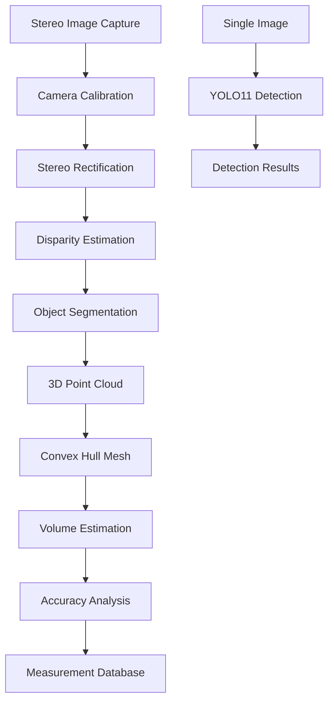

# 📦 VoluSense AI

### Intelligent 3D Reconstruction & Volume Estimation System


## 📌 Project Overview

VoluSense AI is a computer vision application designed
to reconstruct objects in 3D and estimate their volume
using calibrated stereo camera images.

The system combines stereo vision, AI object detection,
image processing, interactive 3D visualization and
experimental performance analysis.

## 🚀 Key Features

- YOLO11-based object detection
- Stereo camera calibration
- Stereo disparity estimation
- Object segmentation
- Interactive 3D point cloud visualization
- Approximate 3D surface mesh generation
- Automatic dimension and volume estimation
- Persistent measurement history using SQLite
- MAE, RMSE and MAPE analysis
- Downloadable CSV measurement reports
- Interactive Streamlit dashboard

## 🛠️ Technology Stack

| Technology | Purpose |
|---|---|
| Python | Core programming |
| OpenCV | Computer vision and calibration |
| YOLO11 | AI object detection |
| NumPy | Numerical computation |
| SciPy | Convex hull and volume estimation |
| Plotly | Interactive 3D visualization |
| Streamlit | Web application |
| Pandas | Data analysis |
| SQLite | Measurement storage |

## 🏗️ System Architecture



## 📂 Project Structure

```text
VoluSense-AI/
├── app.py
├── ai_detector.py
├── calibration.py
├── volume_estimator.py
├── visualization.py
├── database.py
├── fix_calibration.py
├── resize_images.py
├── resize_objects.py
├── test_checkerboard.py
├── requirements.txt
├── .streamlit/
├── .gitignore
└── README.md
```

## ⚙️ Installation

Clone the repository:

```bash
git clone https://github.com/SOFEEN-ZAID/VoluSense-AI.git
cd VoluSense-AI
```

Create a virtual environment:

```bash
python -m venv venv
```

Activate the environment on Windows:

```bash
venv\Scripts\activate
```

Install dependencies:

```bash
python -m pip install -r requirements.txt
```

## ▶️ Run the Application

```bash
python -m streamlit run app.py
```

Open the localhost URL displayed in the terminal.

The pretrained YOLO model may download automatically
during the first object detection.

## 🖥️ Application Modules

### 1. Home
Project overview and simulated 3D demonstration.

### 2. AI Object Detection
Object identification using YOLO11 with confidence scores.

### 3. 3D Reconstruction
Stereo reconstruction, disparity maps, segmentation,
point clouds, approximate meshes and volume estimation.

### 4. Measurement History
Persistent storage and CSV report generation.

### 5. Accuracy Analysis
Comparison of estimated and physically measured volumes.

## 📊 Performance Evaluation

The system supports the following evaluation metrics:

- Mean Absolute Error (MAE)
- Root Mean Squared Error (RMSE)
- Mean Absolute Percentage Error (MAPE)

Physical water-displacement measurements can be used
as reference volumes for suitable objects.

## 📸 Dataset

The project uses self-captured stereo image pairs of
produce and package objects.

Camera calibration is performed using a checkerboard
pattern and OpenCV.

Personal datasets and calibration files are excluded
from this repository.

Real reconstruction requires a compatible calibration
file and matching stereo images captured with the same
camera setup.

## ⚠️ Limitations

- Accuracy depends on camera calibration and image quality.
- Convex hull reconstruction approximates object geometry.
- A single stereo pair cannot capture every hidden surface.
- YOLO detection is a separate application module.
- Numerical accuracy requires experimental validation.

## 🌍 Real-World Applications

- Smart agriculture
- Fruit and vegetable grading
- E-commerce package sizing
- Warehouse automation
- Logistics management
- Industrial quality inspection

## 🔮 Future Enhancements

- Deep learning-based stereo depth estimation
- AI-powered object segmentation
- Complete multi-view 3D reconstruction
- PLY and OBJ model export
- Automated PDF measurement reports
- Cloud deployment

## 👨‍💻 Developer

**Sofeen Zaid**

AI & Machine Learning Student

GitHub: https://github.com/SOFEEN-ZAID

## ⭐ Project

Academic and computer vision portfolio project.
